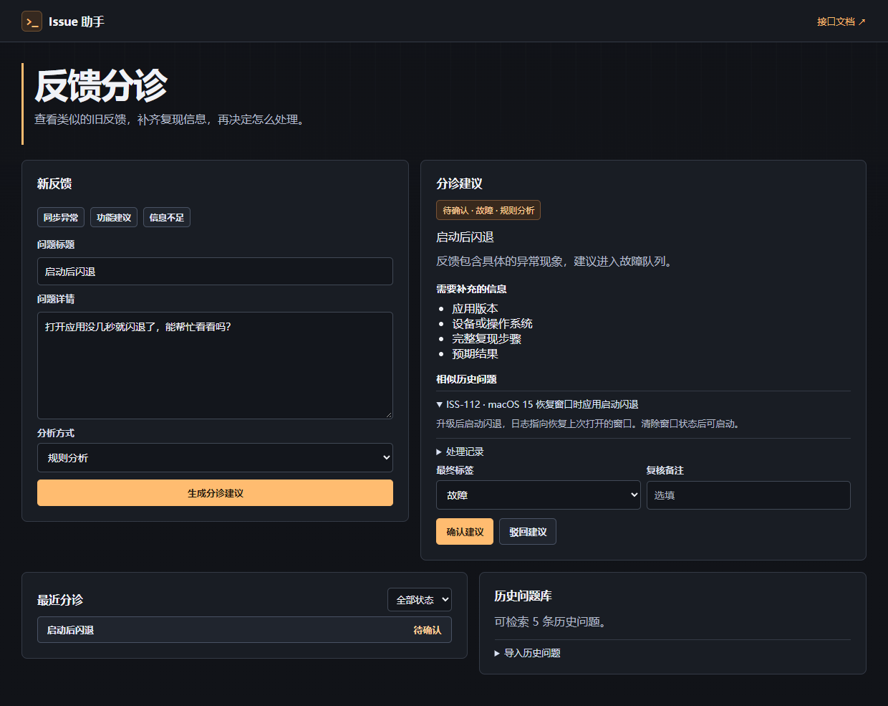

# Issue 助手

收到“启动后闪退”这类反馈，维护人员通常要先翻旧记录，再问版本、系统和复现步骤。这个工具把要查的旧问题和要追问的信息列在一处，最后由维护人员确认分类。



## 用样例走一次分诊

1. 在 Windows 双击 `启动项目.cmd`。也可以用 Python 3.12 安装 `requirements.txt` 后运行 `python launch.py`。打开 [本地页面](http://127.0.0.1:8768/)。
2. 点「信息不足」，再点「生成分诊建议」。展开相似的旧反馈 **ISS-112**，核对本次情况是否真的相同，右侧也会列出还需要补充的字段。
3. 修改最终标签或填写备注后确认。把「最近分诊」切到「已确认」，重新打开刚才的记录，可对照初始建议和人工结论。
4. 有自己的历史记录时，展开「导入历史问题」，下载示例 JSON，按 `id`、`title` 和 `body` 填写。已有编号会更新，每批最多 200 条。

## 为什么保留两份结果

建议生成后会停在「待确认」。如果维护人员把“故障”改成“使用咨询”，原建议仍可拿来复盘，最终标签和备注单独记录。SQLite 将状态变化和处理记录放进同一个事务。重复提交同一个决定会返回原记录，如果两次提交互相冲突会返回 HTTP 409。

默认规则模式无需密钥。也可以按 `.env.example` 接入支持 Function Calling 的模型。应用开放两个只读工具，查标签和搜旧反馈。实际确认和驳回仍由页面发起。

分诊和事务在 [issue_service.py](app/issue_service.py)，历史样例在 [examples.json](app/examples.json)。本地库文件为 `data/issues.sqlite3`。

## 回归检查

```sh
python -m unittest discover -s tests -v
```

覆盖历史问题导入更新、并发确认、冲突处理和旧记录恢复。运行中可打开 [API 文档](http://127.0.0.1:8768/docs)。
